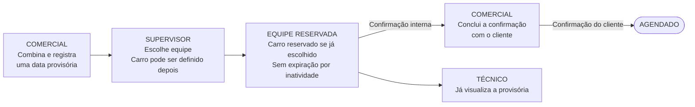
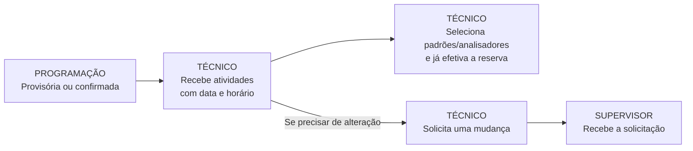
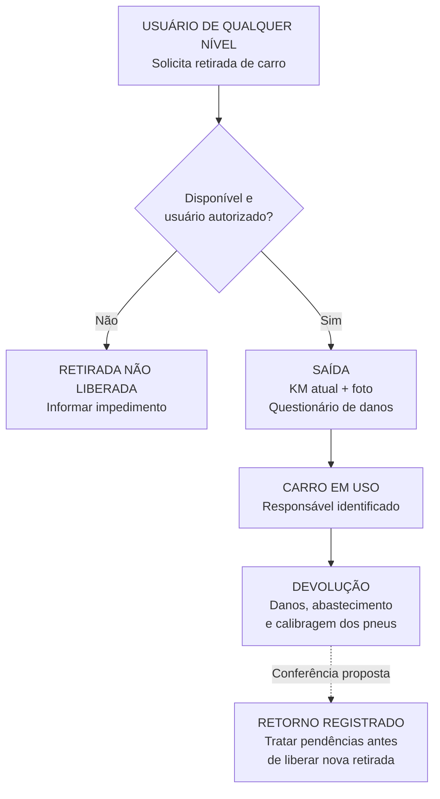

# ATEM Field — fluxo de agendamento

Versão 0.4 · 21/09/2026 · Atualizado com as respostas da entrevista; aguardando autorização para implementação.

Objetivo: organizar a passagem de trabalho entre comercial, supervisão e técnicos no painel planejado com NocoBase. Este documento descreve o processo, não uma funcionalidade já implantada.

## Gerente: atuação transversal

O gerente pode interagir com todos os usuários e fluxos, editar/reagendar, trocar técnicos e carros, alterar prioridades, cancelar e configurar campos/etapas. Fica fora das aprovações obrigatórias. Intervir na agenda não substitui a identificação de quem retira o carro nem apaga a posse física em andamento.

## 1. Agendamento com o cliente

A validação do supervisor não substitui a confirmação com o cliente. O técnico pode ver a provisória; essa visibilidade não autoriza, por si só, saída com veículo ou início do atendimento. A reserva não expira por inatividade; pode haver notificação após dois dias sem alterações, com detalhes ainda a definir.

Carro pode ser definido depois da validação e da confirmação do cliente. Enquanto isso, indicar carro a definir, sem reserva fictícia. Proposta: vinculação posterior verifica disponibilidade e reserva o carro. Analisadores são reservados ao efetivar sua seleção, conforme fluxo abaixo.

## 2. Preparação técnica e pedidos de mudança

Não existe etapa obrigatória de aceite/recusa do técnico. O recebimento provisório e o encaminhamento de mudanças ao supervisor estão confirmados.

A seleção efetivada de padrões/analisadores já gera reserva imediata, em qualquer momento do agendamento provisório ou confirmado. Não depende de aprovação adicional nem da confirmação do cliente. Recursos reservados, emprestados ou com outros impedimentos não podem ser retirados. Calibração/certificado vencido permite retirada com aviso, conforme confirmação do usuário. Essa exceção não anula outros bloqueios. O tratamento das mudanças e a reconfirmação com o cliente serão detalhados.

## 3. Frota — retirada e devolução

Qualquer integrante escalado pode retirar o carro reservado à agenda; o responsável real pela retirada fica identificado. Outro usuário pode utilizar hoje um carro reservado para amanhã, desde que respeite os horários e a margem de retorno. Reserva de horário e carro fisicamente em uso são situações diferentes. A duração da margem e a antecedência permitida ainda serão definidas.

A última etapa tracejada é uma proposta: registrar o retorno físico, mantendo indisponibilidade quando houver pendências de conferência. KM/foto na devolução também estão propostos no plano de frota, inspirados no Field Control. Perguntar sobre abastecimento/calibragem não significa obrigar uma resposta positiva.

## Decisões em aberto para completar o fluxo

1. Duração da margem de retorno e antecedência de retirada; o uso anterior sem conflito e a retirada por qualquer integrante escalado estão confirmados.
2. Autorização de retirada física na fase provisória; definição posterior do carro já está permitida.
3. Detalhes do aviso após dois dias: contagem, destinatários e repetição.
4. Eventos de liberação e procedimento de retirada da reserva própria de padrões/analisadores; início da reserva na seleção já está definido.
5. Questionários finais, fotos no retorno, tratamento de dano e divergência de KM.
6. Campos obrigatórios/customizados, distribuição entre supervisores e integração de agendas.
7. Reagendamentos, cancelamentos e critérios de execução/encerramento.

## Limite preservado

O PDF atual da ferramenta de relatório de campo permanece intacto: conteúdo, formato e geração. Uma eventual associação entre atendimento e relatório será discutida sem alterar esse módulo.

## Evolução desta versão

- 0.1 — primeira representação das regras já confirmadas; pendências explicitadas, sem antecipar aprovações ou reservas automáticas.
- 0.2 — reserva sem expiração, técnico vendo provisória, poderes gerenciais definidos, menu Frota e tratamento de analisadores acrescentados. Regras restantes sinalizadas como pendentes/propostas.
- 0.3 — uso antes de reserva futura com margem, retirada por qualquer integrante escalado e exceção de calibração/certificado vencido confirmados. Reserva automática do fluxograma delimitada a equipe/carro.
- Nas próximas revisões, incorporar as respostas da entrevista e registrar mudanças nas regras. Não tratar propostas como decisões aprovadas.

Referências de trabalho: [plano consolidado](./plano-consolidado-atem-field.md) e [planejamento detalhado](./nocobase-workflow-agendamento.md).
Atualização 0.4 — 21/09: carro posterior permitido e reserva imediata de padrões/analisadores em agenda provisória ou confirmada. Construção aguarda ordem expressa.
